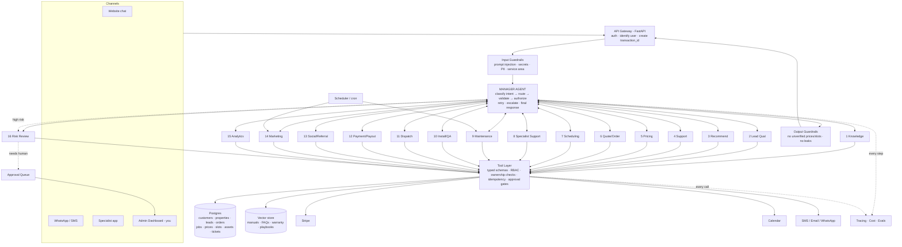

# Architecture

## System diagram

## Layers, top to bottom

| Layer | Job | Built with |
|---|---|---|
| Channels | Where people talk to Stoupons | Streamlit chat, later the website widget and WhatsApp through Twilio |
| API Gateway | Logs the user in and attaches IDs to every request | FastAPI |
| Input Guardrails | Blocks bad input before any LLM sees it | Python rules + Claude Haiku classifier |
| Manager Agent | Decides which worker handles the request and checks the result | Claude Opus (router: Claude Haiku) |
| Worker Agents | Each does one job well | Claude + Anthropic SDK Tool Runner |
| Tool Layer | **The only path to real data.** Checks permissions and runs the action | Plain Python functions + Pydantic |
| Systems of record | The truth | Postgres, Stripe, Calendar, vector store |
| Output Guardrails | Checks the answer before the customer sees it | Python rules |
| Approval Queue | Waits for a human (you) on risky actions | A database table + a dashboard page |
| Tracing | Records what happened, why, and what it cost | Langfuse / Arize Phoenix |

## Non-negotiable rules

1. **LLMs never touch the database directly.** They *request* a tool, and Python code checks permission, then runs it.
2. **RAG is for knowledge only** (manuals, FAQs, warranty text, playbooks). Prices, discounts, payment state, slots, availability, payouts, order status and entitlements come **only** from tools and APIs.
3. **Shared IDs travel with every handoff:** `transaction_id`, `customer_id`, `property_id`, `order_id`, `job_id`.
4. **Approval gates are code, not prompts.** The approval matrix lives in config, and the tool layer enforces it.
5. **Least privilege.** Each agent gets only the tools it needs.
6. **Fail safe.** If data is missing or a tool fails, escalate. Never guess.

## The commerce flow (17 steps) and which agent owns each step

| Step | Owner |
|---|---|
| 1. Identify and authorize customer | API Gateway + Manager |
| 2. Load customer and property state | Manager → Support tools |
| 3. Qualify request | #2 Lead Qualification |
| 4. Retrieve approved product facts | #1 Knowledge |
| 5. Calculate price with the pricing tool | #5 Pricing |
| 6. Present options | #3 Recommendation + #5 Pricing |
| 7. Get explicit customer confirmation | #6 Quote & Order |
| 8. Create quote and order | #6 Quote & Order |
| 9. Confirm payment or deposit | #12 Payment |
| 10. Fetch real slots | #7 Scheduling |
| 11. Book slot | #7 Scheduling |
| 12. Dispatch specialist | #11 Dispatch |
| 13. Confirm specialist acceptance | #11 Dispatch + #8 Specialist Support |
| 14. Track installation | #10 Installation & QA |
| 15. Verify completion evidence | #10 Installation & QA |
| 16. Activate asset, warranty and maintenance records | #9 Maintenance |
| 17. Trigger review, referral and social workflows | #13 Social & Referral |

## How it grows

| Stage | Data | Hosting |
|---|---|---|
| Learning (Phases 0–2) | `data/mock/*.json` | Your laptop |
| Real data (Phase 3+) | SQLite, then Supabase Postgres + pgvector | Laptop, then Render/Railway |
| Production (Phase 6) | Postgres + Stripe + Calendar + Twilio | Render/Railway/Fly.io; Streamlit or Next.js dashboard |
